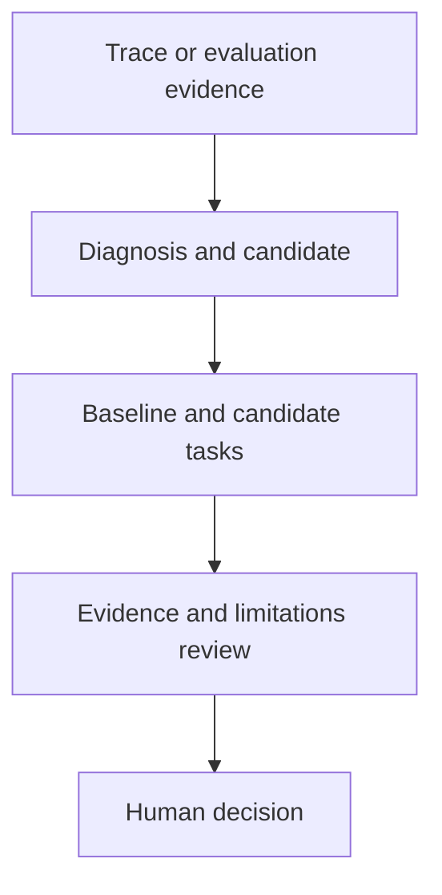

# Agent Harness Lab

**Improve coding-agent harnesses with evidence, not guesswork.**

An experimental open-source toolkit for diagnosing coding-agent behavior,
evaluating harness changes against baselines, and reviewing evidence before adoption.
For developers maintaining `AGENTS.md`, `CLAUDE.md`, project skills and repeated
coding-agent workflows, and engineers investigating agent evaluation.

**Experimental:** broad improvements in agent success are unproven. Automatic
behavioral adoption is blocked pending independent certification safeguards.

Agent-backed workflows support **Claude Code and Codex**. The offline example below
needs neither runtime, credentials nor model inference. Python 3.11+ is required;
the default core uses only the standard library.

[Quickstart](#try-it-without-credentials) · [Install](docs/installation.md) ·
[Documentation](docs/README.md) · [Contribute](CONTRIBUTING.md) · [Support](SUPPORT.md)

## Try it without credentials

Requires Git, Python 3.11+ and a POSIX shell. This uses the current source checkout;
the latest published release may not yet include the new example.

```sh
git clone https://github.com/mihazs/agent-harness-lab.git
cd agent-harness-lab
python3 -m agent_harness_lab --help
python3 -m agent_harness_lab diagnose --events examples/repeated-observation.jsonl --output /tmp/ahl-first-diagnosis
cat /tmp/ahl-first-diagnosis/report.md
```

Choose a new output path if `/tmp/ahl-first-diagnosis` already exists. Nothing is
installed globally. This command reads only the supplied synthetic event file,
writes the report locally and does not start an agent.

Actual report excerpt:

```text
Events: 4; cases: 1.
Observed findings: 1.
Recurring sequences: 0.
```

The finding is `duplicate_observation`: two read-only calls have matching tool,
input, result and recorded state. This is an **observed pattern**, not proof of
waste or a recommendation to remove a check. Outcomes and independence are unknown.
Read the [full output, controls and interpretation](docs/getting-started.md).

## How it works

1. **Inspect evidence:** analyze scoped traces or supplied synthetic events.
2. **Compare a candidate:** stage instruction/skill changes and run prepared
   baseline/candidate tasks under a selected runtime.
3. **Review limitations:** inspect outcomes, grader controls and uncertainty before
   making a decision. Behavioral changes remain recommendations.



Editing `AGENTS.md` changes instructions; AHL adds an evidence collection,
diagnosis and comparison workflow around those changes. It does not establish
that an instruction edit caused better performance.

## What you can try

| Need | Entry point | Inference |
| --- | --- | --- |
| Inspect an explicit event file | `ahl diagnose --events FILE --output NEW_DIR` | None |
| Discover local project evidence | `ahl analyze [project]` | None |
| Inspect recurring transitions | `ahl mine FILE` | None |
| Inspect bundled synthetic tasks | `ahl bank --starter --list` | None |
| Validate a declared regression reproduction | `ahl regression --proposal PATH` | Explicitly authorized local record; no replay or admission |
| Accept a reviewed private regression | [`ahl regression-review ... accept`](docs/regression-admission.md) | None; explicit sealed case and immutable parent bank |
| Record comparisons and quarantine defective graders | [`ahl experiment-history`](docs/oracle-history.md) | None; explicit pinned offline profile |
| Stage and evaluate a candidate | `ahl improve [project]` | Codex/Claude Code or explicit Responses settings |
| Recheck changed evidence | `ahl watch [project]` | Each triggered improvement may use inference |
| Run prepared tasks with controller inference | `ahl evaluate --agent responses ...` | Explicit private API settings and resource profiles |

See [all workflows and commands](docs/workflows.md). Installed skills can also run
inside an agent session. Never enable runtime permission bypass to use AHL.

## Safety, privacy and evidence

- Use trusted projects and synthetic fixtures. Agent runtimes, inherited hooks and
  cooperative graders are **not a hostile-code security sandbox**. Optional
  [`--sandbox-graders`](docs/workflows.md#automatic-improvement) isolates artifact
  grading on supported Linux hosts; native agent execution remains cooperative.
- Real-world diagnostic accuracy and general performance gains are unestablished.
  Synthetic checks exercise implementation behavior; they do not certify improvement.
- Repetition is not waste. Fewer tool calls count as an improvement only when required
  behavior and outcomes are preserved.
- Keep private traces, project identities, history-derived findings, credentials and
  trial workspaces out of commits and public issues. Normalization is not sanitization.
- Agent-backed workflows use your runtime configuration and may incur model costs.
  Installation starts no background monitor.

[Evaluation contracts and pending safeguards](docs/evaluation-foundation.md) ·
[Implemented and pending experiments](docs/controlled-experiments.md) ·
[Scientific sources](skills/harness-evaluation/references/evidence-to-design.md) ·
[Initial validation](docs/validation.md) · [Scientific roadmap](https://github.com/mihazs/agent-harness-lab/issues/3)

## Contribute

Start with the [contributor guide](CONTRIBUTING.md) for setup, architecture, tests
and choosing a bounded task. Documentation, synthetic fixtures and focused tests
are useful contributions alongside research work.

Questions and reproducible bugs belong in [Issues](https://github.com/mihazs/agent-harness-lab/issues)
while Discussions is unavailable. See [support](SUPPORT.md), [private security reporting](SECURITY.md)
and the [code of conduct](CODE_OF_CONDUCT.md). No response-time commitment is made.

Versions use Changesets; do not change version numbers manually. For a releasable
change, run `task setup` and `task changeset`; see [release conventions](CONTRIBUTING.md#versions-and-changelogs).

Use `task test` to run both native suites below. Reusable commands belong in
`Taskfile.yml`; source, wheel and archive checks share discoverable unittest cases.

```sh
python3 -m unittest discover -s skills/harness-evaluation/scripts -p 'test_*.py'
python3 -m unittest discover -s tools/tests -p 'test_*.py'
```

Licensed under [MIT](LICENSE).
