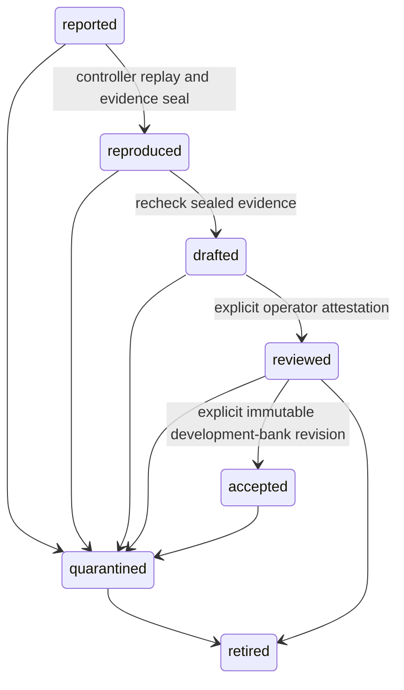

# Reviewing a private regression case

New in 0.41, `ahl regression-review` records an explicit controller-owned case
workflow. It reuses the [reproduction declarations and offline replay](regression-proposals.md).
It never imports a caller's success receipt, modifies an active bank or publishes
case data. Version 0.44 adds explicit [immutable development-bank admission](regression-admission.md)
after operator review; it does not modify an active bank or establish independent roots.

Rejection and retirement are terminal. Quarantine retains the old evidence and
may later be rejected or retired; it does not reopen a changed oracle. Corrected
declarations form a new case with the same known root/provenance, rather than
overwriting the old one.

## Operator sequence

Supply `--store` before the action. It must be a new or empty private directory,
or a recognized controller store, outside every case source tree. Initialization
writes a versioned `.store.json`; read/review operations cannot initialize an
unrelated directory. The store root must belong to the current user with mode
0700. No store, input, image or credential location is discovered automatically.

1. `propose --proposal P --draft D --replay R --author AUTHOR` reads exactly the
   three explicitly authorized declaration files. The case ID binds their exact
   byte hashes; duplicates cannot overwrite history. Original absolute locators
   stay private, while copied declaration bytes remain unchanged. Relative paths
   retain their original declaration-directory meaning; copying does not rebase
   them. This step validates metadata without executing a case.
2. `reproduce --case CASE_SHA256 --cgroup-root DIR --image-root DIR
   --image-sha256 SHA256 --disk-bytes BYTES` requires the complete offline profile.
   The original declarations must still match their recorded hashes. The
   controller persists an attempt-start event, freezes bounded raw/materialized
   controls, then invokes the actual offline replay. The optional
   `--budget-seconds` defaults to 60 and cannot exceed 300; one absolute deadline
   includes lifecycle preflight and narrows every nested operation.
3. `draft --case CASE_SHA256` rechecks the sealed evidence. Only a reproduced
   local failure with intact A/A and minimization comparisons can advance. An
   observed repair is not required to nominate an unfixed regression. A merely
   completed replay, baseline already passing, unstable control or environment
   defect cannot advance the case.
4. `show --case CASE_SHA256` returns recorded state, current event/evidence hashes
   and bounded attempt dispositions. Use those hashes in the review record.
   Showing state does not revalidate every artifact; drafting and positive review
   perform that validation.
5. `review --case CASE_SHA256 --record REVIEW_JSON` records the explicit operator
   decision after validating its exact event and evidence binding.

For example, the command prefix is
`ahl regression-review --store /path/to/private-store`; append one action above.
These are local operator commands, not a model-driven acceptance loop.

## Exact review record

Version 1 requires exactly these fields:

| Field | Contract |
| --- | --- |
| `schema_version` | Integer `1` |
| `case_id` | Exact case SHA-256 |
| `expected_event_sha256` | Current journal-head hash from `show` |
| `evidence_sha256` | Current evidence hash, or JSON `null` before evidence exists |
| `decision` | `reviewed`, `quarantined`, `rejected`, `retired`, or the interrupted-attempt `reported` decision |
| `reviewer` | Exactly `identity`, `source`, `provenance`, `basis_kind`, `basis` |
| `evidence_refs` | Bounded opaque reference/hash list in the reproduction format |
| `reason` | Nonempty bounded single-line explanation |

`reviewer.source` must be `operator_attestation`. All reviewer text is bounded;
identities have at most 128 characters. Positive review requires a different
author/reviewer identity, `basis_kind: independent_artifact_review`, a described
basis and nonempty evidence references. Fresh-session-only claims are rejected.
Other decisions can use a bounded label such as `operator_intervention`.

These are declared operator identities and provenance, not authenticated people
or cryptographic proof of independence. Different strings are insufficient proof.
The output explicitly calls the review `operator_attested`; historical
verification and task/root independence stay unverified. Private host access to
the controller store is the authority boundary. Workers do not receive that
store as an input; the kernel canary separately attempts and fails to read it.

## Evidence, interruption and privacy

The seal binds the controller-created replay receipt, five-control receipt,
phase results, frozen views/fixtures/oracle, raw and materialized controls
(including controls outside the oracle) and actual allowlisted artifact hashes.
Raw model claims or a supplied positive JSON object cannot create this evidence.
Changed critical evidence appends quarantine without rewriting older events.

Positive reproduction events commit after critical evidence files and their
directory entries have been synced. Attempt-start records precede the work. The
API never overwrites committed events; each event links to its predecessor hash.
Gaps, corrupt tails or incompatible transitions fail closed without truncation.
A local hash chain does not authenticate the host account or prevent a complete
rewrite by that account. Owner-controlled files are not a third-party certificate.

An interrupted attempt remains `uncommitted`, never automatically adopted. After
confirming intervention is appropriate, an operator may submit a review with
decision `reported`, the exact current head/evidence identities and an explanation.
That appends abandonment of the uncommitted attempt; a later reproduction uses a
fresh controller-generated run directory. Ordinary completed-but-unqualified
attempts retain their distinct status/disposition and can be explicitly retried.

The nonblocking store lock serializes operations; contention returns busy/exit 3.
Journal capacity is 64 events, with completion/review/intervention capacity
reserved before dispatch. Incoming review files are limited to 64 KiB and full
encoded events to 256 KiB before writing. Each P/D/R declaration is at most
256 KiB. Invalid input returns exit 2 with a generic diagnostic, retaining private
history. Successful state operations return 0; unsuccessful reproduction returns
1, or 3 for blocked containment. Only the separate explicit `accept` action can
admit a bank case; other successful state operations do not.

Controller metadata uses mode 0600 under private directories. Copied data retains
its hashed modes beneath private ancestors. Summaries omit author names, original
locators and freeform prose, but even their hashes remain private-derived data.
Private declarations, snapshots, raw runs, reviews, receipts and aggregates must
stay private. Nothing in this workflow authorizes publication, automatic promotion,
historical authentication or causal-effect claims.

Run `task test:evaluation:review` for native lifecycle/falsifier tests. The existing
`task test:sandbox:kernel:regressions` also exercises the actual pinned-image
workflow with resource controls and a synthetic operator attestation; that fixture
does not establish authenticated human independence.
